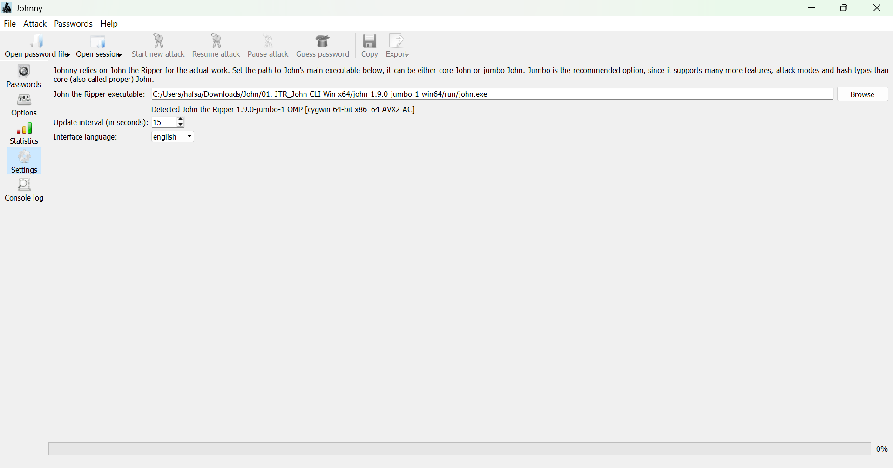

# 🔐 Password Cracking & Hash Analysis

### Cybersecurity Internship | Week 03

**Networkwalks**

---

## 📌 Project Overview

## 👋 Introduction

As part of my Cybersecurity Internship at **Networkwalks**, I successfully completed this Week 3 hands-on project focused on **Password Cracking and Hash Analysis**. This practical exercise provided an opportunity to work with John the Ripper (JTR) and Networkwalks hashing tools to explore document hash extraction, password recovery techniques, and the importance of password security through authorized security testing.

The exercise involved working with three password-protected PDF documents provided for authorized security testing.

## 🎯 Project Modules

| Module | Description |
|---|---|
| W3-PM1 | Password Cracking with John the Ripper (JTR) |
| W3-PM2 | Password Cracking with Networkwalks Tools |

## 🛠️ Tools & Technologies

- **John the Ripper (JTR):** Password auditing and recovery.
- **Johnny 2.2:** Front end interface for John the Ripper.
- **Networkwalks Hash Extractor:** Extracting hashes from protected PDF documents.
- **Networkwalks Hashing Calculator:** Performing hash-related operations.

## ⚙️ Practical Implementation

### W3-PM1: Password Cracking with JTR

1. Downloaded and installed John the Ripper.
2. Installed and configured Johnny 2.2.
3. Extracted hashes from three password-protected PDF files.
4. Loaded the extracted hashes into the password recovery workflow.
5. Executed password recovery attempts using JTR.
6. Reviewed and documented the results.

### W3-PM2: Password Cracking with Networkwalks Tools

1. Accessed the Networkwalks Hash Extractor.
2. Extracted document hashes for analysis.
3. Used the Networkwalks Hashing Calculator.
4. Practiced hash-related operations and password recovery.
5. Documented the practical results.

---

## 📸 Project Demonstration

### 1. John the Ripper (JTR) – Setup

### 2. PDF  – Password  Networkwalks HASHING PASSWORD CRACKERING TOOL Result

### 3. PDF2  – Password Recovery Result

### 4. PDF3  – Password Recovery Result

### 5.PDF-1 Successful PDF Recovery – Final Result

## 📚 Key Learning Outcomes

- Understanding document password protection and hash extraction.
- Hands-on experience with John the Ripper and Johnny 2.2.
- Practical exposure to password recovery techniques.
- Understanding the importance of password complexity.
- Learning how password auditing supports cybersecurity assessments.

## 🔒 Ethical Considerations

This project was conducted with explicit authorization from **Networkwalks** and was performed strictly for educational, training, and cybersecurity research purposes.

## 🙏 Acknowledgement

Special thanks to **Waqas Karim (CCIE)** and **Networkwalks** for providing this valuable learning opportunity and helping me strengthen my practical cybersecurity knowledge.

---

### 🚀 Continuous Learning | Practical Experience | Cybersecurity

**Week 03 – Project Completed**

